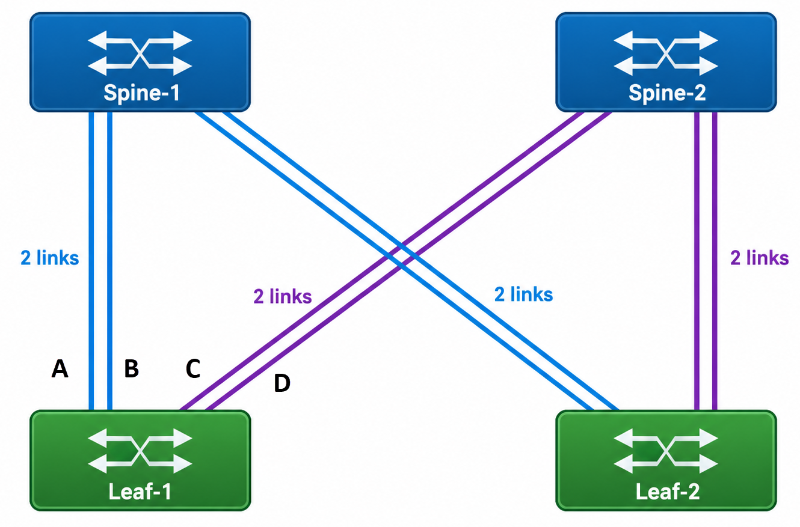

# ECMP Variants


## The Disruption Problem

In static ECMP, the number of buckets exactly equals the number of active next-hops, and each next-hop owns exactly one bucket.


This means any membership change forces a complete rebuild of the hash-to-bucket mapping.

### Addition

When a new next-hop is added (e.g., Server E joins), the bucket count increases and the hash modulus changes. The ASIC recalculates the mapping for all flows, not just the ones that will use the new path. Flows that were stable on their existing paths get reassigned to different next-hops, causing out-of-order packets.


### Removal

The same reshuffling occurs when a next-hop fails or is withdrawn. For example, when Server B fails, its bucket is removed and the total shrinks from four to three. The hash recalculation disrupts all remaining flows including those that had no relationship to Server B.


### The Partial Fix — Consistent Hashing

To fix the reshuffling caused by static ECMP, engineers introduced Consistent Hashing. Consistent hashing decouples the number of buckets from the number of next-hops by creating a fixed-size container. Instead of having exactly 4 buckets for 4 servers, the switch might be configured with a fixed pool of 12 buckets, which are dealt out evenly (e.g., 3 buckets per server).

When an ECMP member fails or is removed, the number of hash buckets does not shrink. Instead, the specific buckets that belonged to the dead member are redistributed to the surviving next-hops.

The following figure shows 4 next-hops assigned in a round-robin fashion to a fixed pool of 12 buckets — 3 buckets per next-hop.


Because the number of buckets is fixed, removing a next-hop no longer changes the math for the entire group. When Next-Hop B fails, the total number of buckets (12) does not change.


The system only takes the specific buckets mapped to the failed node and redistributes them to surviving next-hops. Healthy flows remain completely undisturbed.


However, consistent hashing does not prevent disruption when a new next-hop is added. Because the bucket count is fixed, adding a new next-hop means stealing buckets from existing next-hops to give to the new one, which can still disrupt active flows. The following figure shows adding Next-Hop E requires shifting some existing buckets (3 and 8) to make room, which can disrupt active sessions.


### The Complete Solution — Resilient Hashing

Resilient Hashing builds directly upon Consistent Hashing to solve the final puzzle piece: how to add a new server gracefully without breaking active sessions. It uses the same fixed-size bucket pool, but adds intelligence to how buckets are reassigned during membership changes, minimizing disruption to active flows. The specific implementation differs by ASIC vendor:

#### Broadcom (Immediate Redistribution)

On Broadcom ASICs (Tomahawk, Trident series), resilient hashing operates without timers or background monitoring:
- When a next-hop is **removed**, its buckets are immediately redistributed to the surviving next-hops.
- When a next-hop is **added**, some buckets are immediately migrated from existing next-hops to the new one.
- The algorithm balances buckets as evenly as possible across all next-hops. Assignment does not change for any reason other than membership changes (it does not react to traffic load or bucket activity).

This is simple and deterministic, but the immediate migration on addition can disrupt active flows that happen to occupy the stolen buckets.

#### Nvidia / Mellanox Spectrum (Timer-based, Gradual)

On Nvidia Spectrum ASICs, a background thread manages bucket migration using two configurable timers:
- `active_flow_timer`: Defines how long a bucket must be continuously idle (no traffic) before it is considered safe to migrate. The default is typically 120 seconds.
- `max_unbalanced_timer`: A hard ceiling on how long the system is allowed to remain unbalanced. If this timer expires and there are still not enough idle buckets, the switch forces a migration as a safety net.

The step-by-step process:
1. A new next-hop is added. It receives zero buckets.
2. The background thread continuously scans all buckets for activity.
3. When a bucket has been idle for the full `active_flow_timer` duration, it is migrated to the new next-hop.
4. If the `max_unbalanced_timer` expires before enough idle buckets are found, the thread forces a rebalance (which may disrupt active sessions).

This timer-based approach protects long-lived sessions from disruption during scale-out events, at the cost of temporarily uneven distribution until buckets naturally become idle. In networks with highly persistent flows, the new next-hop may remain underutilized for an extended period.

#### Bucket Count Trade-offs

Resilient hashing uses a finite, hardware-level pool of buckets that is shared across all ECMP groups on the switch. The number of buckets per ECMP group is configurable (common options: 64, 128, 256, 512, or 1024), and this choice represents a direct trade-off:

- **More buckets per group:** Reduces the disruption impact when a next-hop is added or removed (a smaller percentage of flows are affected). However, the total number of ECMP groups the switch can support decreases because the shared hardware pool is consumed faster.

- **Fewer buckets per group:** Supports more ECMP groups simultaneously, but each add/remove event disrupts a larger proportion of flows.

If the maximum number of ECMP groups is reached, new ECMP routes cannot be installed and are rejected by the hardware.


## Fine-Grained ECMP

Consistent hashing and resilient hashing solve the disruption problem in hardware, but their bucket redistribution is **topology-unaware**. The ASIC treats all next-hops as interchangeable — it has no knowledge of which upstream router each next-hop traverses.

To see why this matters, consider the following 2-Leaf, 2-Spine Clos fabric. Each leaf connects to each spine with 2 links, so Leaf-1 has 4 ECMP next-hops to reach any destination behind Leaf-2.



From Leaf-1's perspective, its ECMP group has 4 members: 2 links via Spine-1 and 2 links via Spine-2. Using 12 buckets (3 per link), the initial state is:

```text
Initial State (12 buckets, 4 links)

    Bucket  0 → Spine-1 Link-A   ┐
    Bucket  1 → Spine-1 Link-A   ├─ Spine-1 (25%)
    Bucket  2 → Spine-1 Link-A   ┘
    Bucket  3 → Spine-1 Link-B   ┐
    Bucket  4 → Spine-1 Link-B   ├─ Spine-1 (25%)
    Bucket  5 → Spine-1 Link-B   ┘
    Bucket  6 → Spine-2 Link-C   ┐
    Bucket  7 → Spine-2 Link-C   ├─ Spine-2 (25%)
    Bucket  8 → Spine-2 Link-C   ┘
    Bucket  9 → Spine-2 Link-D   ┐
    Bucket 10 → Spine-2 Link-D   ├─ Spine-2 (25%)
    Bucket 11 → Spine-2 Link-D   ┘

    Spine-1 total: 50%    Spine-2 total: 50%    ✓ Balanced
```

Now suppose **Link-A fails**. Here is how each approach redistributes its 3 orphaned buckets:

```text
Without Topology Awareness (consistent/resilient hashing)

    Leaf-1's ASIC spreads Link-A's buckets equally across ALL 3 survivors:

    Bucket  0 → Spine-1 Link-B   ◄ was Link-A
    Bucket  1 → Spine-2 Link-C   ◄ was Link-A
    Bucket  2 → Spine-2 Link-D   ◄ was Link-A
    Bucket  3 → Spine-1 Link-B
    Bucket  4 → Spine-1 Link-B
    Bucket  5 → Spine-1 Link-B
    Bucket  6 → Spine-2 Link-C
    Bucket  7 → Spine-2 Link-C
    Bucket  8 → Spine-2 Link-C
    Bucket  9 → Spine-2 Link-D
    Bucket 10 → Spine-2 Link-D
    Bucket 11 → Spine-2 Link-D

    Link-B: 4 buckets    Link-C: 4 buckets    Link-D: 4 buckets
    Spine-1 total: 33%   Spine-2 total: 67%   ✗ Unbalanced
```

```text
With Topology Awareness (fine-grained ECMP)

    Software redistributes Link-A's buckets ONLY to Link-B (same spine):

    Bucket  0 → Spine-1 Link-B   ◄ was Link-A
    Bucket  1 → Spine-1 Link-B   ◄ was Link-A
    Bucket  2 → Spine-1 Link-B   ◄ was Link-A
    Bucket  3 → Spine-1 Link-B
    Bucket  4 → Spine-1 Link-B
    Bucket  5 → Spine-1 Link-B
    Bucket  6 → Spine-2 Link-C
    Bucket  7 → Spine-2 Link-C
    Bucket  8 → Spine-2 Link-C
    Bucket  9 → Spine-2 Link-D
    Bucket 10 → Spine-2 Link-D
    Bucket 11 → Spine-2 Link-D

    Link-B: 6 buckets    Link-C: 3 buckets    Link-D: 3 buckets
    Spine-1 total: 50%   Spine-2 total: 50%   ✓ Balanced
```

Without topology awareness, Leaf-1's ASIC sees four flat, interchangeable members with no grouping information. Two-thirds of all traffic now takes the Spine-2 path, overloading it while Spine-1 is underutilized.

The second diagram is what **Fine-Grained ECMP (FG-ECMP)** makes possible. Instead of letting the ASIC manage the bucket array, software pre-computes the entire bucket-to-member mapping and programs it explicitly. The ASIC itself just sees a regular ECMP group with a pre-populated bucket array — all the "fine-grained" intelligence lives in the control plane. Because software knows which links share a spine, it can restrict redistribution to the correct subset of survivors and keep the per-spine traffic ratio intact.

This software ownership enables two key capabilities:

1. **Keep the bucket array size constant** when a member disappears (no modulus change, no global rehash).

2. **Rewrite only the specific buckets** that belonged to the failed member — and restrict that rewrite to a chosen subset of survivors.

### Banks: Limiting the Blast Radius

The topology-aware example above redistributed Link-A's buckets only to Link-B — the other link on the same spine. FG-ECMP formalizes this grouping with **banks** — a label that ties next-hops together by a common property, typically one bank per upstream spine.

A bank is a label attached to each member. Members that share a label form a bank, and each bank owns a contiguous range of the bucket array, sized in proportion to its member count. The critical rule: **when a member fails, its buckets are given only to other members in the same bank.** Members in other banks receive nothing — their bucket ranges, their flows, and their traffic load are all untouched.

Using the same 12-bucket example from above, the two spines become two banks:

```text
Fine-Grained ECMP (4 links, 12 buckets, 2 banks):

  Bank 0 (Spine-1) = { Link-A, Link-B }   owns buckets 0–5    (3 per link)
  Bank 1 (Spine-2) = { Link-C, Link-D }   owns buckets 6–11   (3 per link)

  Link-A fails  →  buckets 0–2 are rewritten to Link-B (same bank)
                   buckets 6–11 (Bank 1) are not touched
```

A failure behind Spine-1 cannot ripple into traffic that was going through Spine-2. This is **bank-scoped failover** — the core value of FG-ECMP.

> Banks are a failover isolation concept, not a traffic-weighting concept. Every member still receives the same number of buckets (`total_buckets / total_members`). In our example, with 12 buckets and 4 links, each link gets exactly 3 buckets (25% of traffic). Each bank owns 6 buckets because it has two members, not because it has higher weight.

### FG-ECMP vs. Standard and Consistent ECMP

| Property                 | Static ECMP         | Consistent ECMP        | Fine-Grained ECMP                        |
|--------------------------|---------------------|------------------------|------------------------------------------|
| **Bucket management**    | Hardware (ASIC)     | Hardware (ASIC)        | Software-controlled                      |
| **Bucket assignment**    | ASIC-managed        | ASIC-managed           | Explicitly programmed per bucket         |
| **Bucket count**         | Equals member count | Fixed (pre-configured) | Fixed (operator-configured)              |
| **Traffic distribution** | Equal per next hop  | Equal per next hop     | Equal per next hop                       |
| **Stable on removal**    | No (full rehash)    | Yes (hardware)         | Yes (bank-scoped redistribution)         |
| **Stable on addition**   | No (full rehash)    | No (bucket steal)      | Partial (proportional steal within bank) |
| **Bank-based failover**  | No                  | No                     | Yes                                      |

Two things to remember about FG-ECMP:

- It is about **stability**, not weighting. Every member always receives the same number of buckets. Per-member weights are not supported.
- It is configured **per destination prefix**, not automatically for all routes. The operator explicitly selects which route prefixes use FG-ECMP and assigns their members to banks.


## Weighted ECMP

Everything covered so far splits traffic **equally** across next hops. **Weighted ECMP** removes this assumption by allowing each next hop to receive a **proportional** share of traffic based on an assigned weight.

> The industry has not settled on a single name. Cumulus Linux (Nvidia) and Nokia use **Weighted ECMP**; SONiC, Google, and SAI use **WCMP** (Weighted Cost Multipath); Cisco and Juniper use **UCMP** (Unequal Cost Multipath). The underlying mechanism is the same in all cases.

### Why It Is Needed

Standard ECMP gives every next hop an equal share of the hash space. That is the wrong answer when the paths themselves are unequal:

- **Mixed link speeds**: Consider a fabric during a rolling upgrade from 40G to 100G. If a leaf has one 100G uplink to Spine A and one 40G uplink to Spine B, standard ECMP splits flows 50/50. The 40G link saturates while the 100G link sits underutilized. Weights of 5:2 match the split to the capacity ratio, steering approximately 71% of flows toward the faster link.

- **Traffic engineering**: Deliberately directing more traffic toward a preferred path, even when link speeds are identical — or gracefully draining a path by ramping its weight down (e.g. weight 4 → 2 → 1 → remove) before taking it out of service.

### How Weights Are Implemented in Hardware

The weight is a **per-member attribute** — it lives on each member inside the group, not on the next hop, the route, or the group itself. Weighted ECMP uses the exact same hash-and-bucket mechanism as standard ECMP. The hash function is unchanged, and a given flow still sticks to exactly one next hop. The only difference is **how buckets are allocated**: a next hop with higher weight owns more buckets.

In standard ECMP, the bucket count equals the member count — one bucket per member. In weighted ECMP, the bucket count is the **sum of the weights**, and each member owns buckets proportional to its weight. The most common hardware technique is **entry replication**: the same physical next hop is listed multiple times in the bucket array.

Take four members and give NH-A weight 2 while the others keep weight 1. The bucket count becomes 2+1+1+1 = 5, the hash becomes `h mod 5`, and two buckets point to NH-A:

```
                                          ┌─ Next Hop Group ──────────────────────────────────────┐
                                          │                                                       │
                                          │   Hash Buckets          Members                       │
                                          │  ┌─────────────┐      ┌───────────────────────────┐   │
  flow 1 ──────┐                          │  │  Bucket 0   │ ──┐  │ #0  NH-A  Eth0   weight 2 │   │
               │    ┌────────┐            │  ├─────────────┤   ├─►│      (2 of 5 buckets)     │   │
  flow 2 ──────┼──► │  Hash  │─ h mod 5 ─►│  │  Bucket 1   │ ──┘  ├───────────────────────────┤   │
               │    │ 5-tuple│            │  ├─────────────┤      │ #1  NH-B  Eth4   weight 1 │   │
  flow 3 ──────┘    └────────┘            │  │  Bucket 2   │ ───► │      (1 of 5 buckets)     │   │
                                          │  ├─────────────┤      ├───────────────────────────┤   │
  (route lookup already                   │  │  Bucket 3   │ ───► │ #2  NH-C  Eth128 weight 1 │   │
   selected this NHG)                     │  ├─────────────┤      │      (1 of 5 buckets)     │   │
                                          │  │  Bucket 4   │ ──┐  ├───────────────────────────┤   │
                                          │  └─────────────┘   └─►│ #3  NH-D  Eth132 weight 1 │   │
                                          │                       │      (1 of 5 buckets)     │   │
                                          │                       └───────────────────────────┘   │
                                          └───────────────────────────────────────────────────────┘

  Result:  NH-A receives ~40% of flows; NH-B, NH-C, NH-D ~20% each.
```

Because each bucket still attracts an equal share of flows (`1/num_buckets`), the hash itself never changes — only the bucket-to-member ownership changes, and that is what shapes the traffic split.

Weights are **ratios**: 2:1:1:1 and 4:2:2:2 produce the same 40/20/20/20 split, just with 5 or 10 buckets. When the summed weights get large, the ASIC may perform **weight normalization** — rescaling them to a smaller total while preserving the same ratio. Standard ECMP is simply the special case where every weight is 1, so bucket count equals member count.

### Weight Sources

Weights can be assigned in two ways:

- **Static configuration**: The operator explicitly sets a weight on each next hop when defining a route (e.g. weight 3 on one path, weight 1 on another).

- **BGP Link Bandwidth**: With the BGP link-bandwidth extended community, routers advertise the capacity of each path. The routing protocol derives weights automatically from these advertised bandwidths — no per-route configuration is needed.

### Limitations

Weighted ECMP inherits the same fundamental constraint as standard ECMP: each flow is pinned to a single bucket and **cannot be split**. The configured weight ratio only holds statistically when there are many small mice flows. A small number of elephant flows can easily skew the actual load far from the intended weights.

Additionally, weighted ECMP complicates [resilient hashing](#the-complete-solution--resilient-hashing). When a next-hop group is resized, redistributing replicated entries can inadvertently alter the intended weight ratio — a problem known as **weight skew**.
